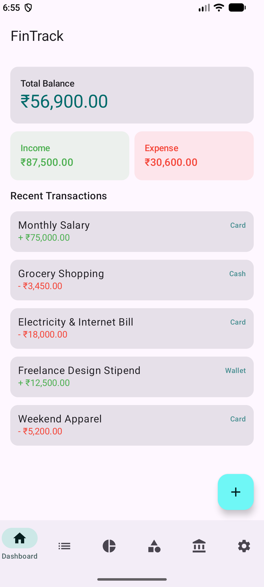
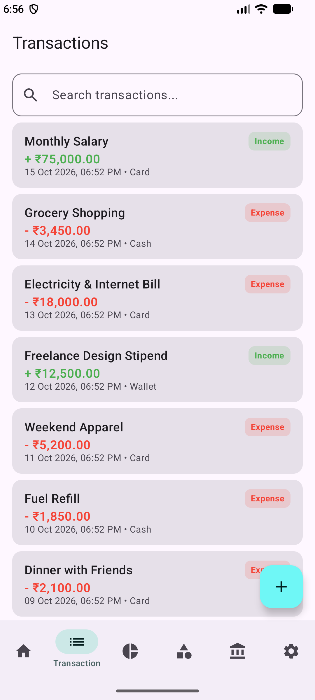
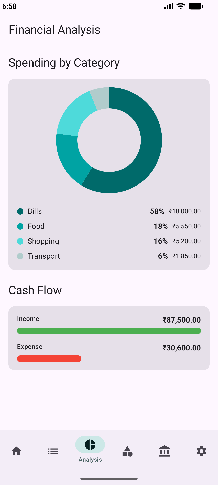
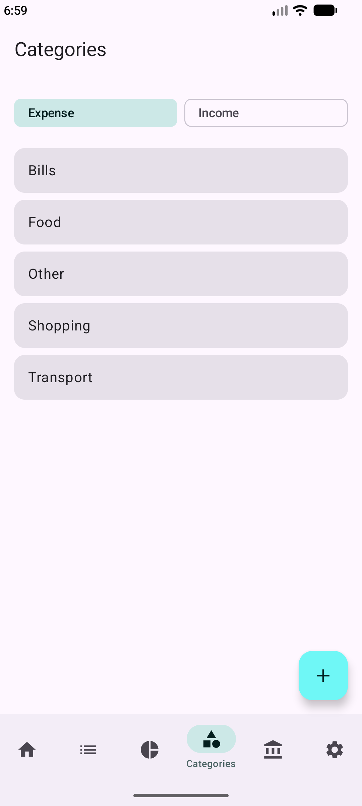
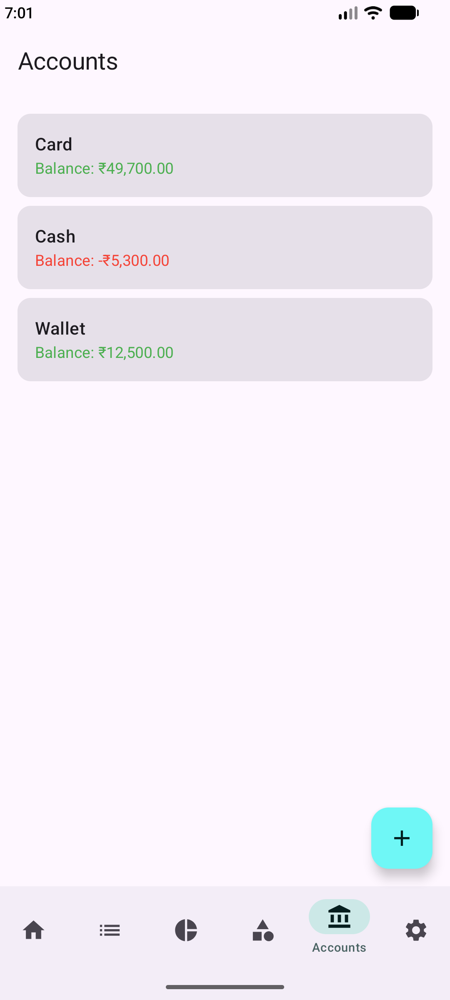
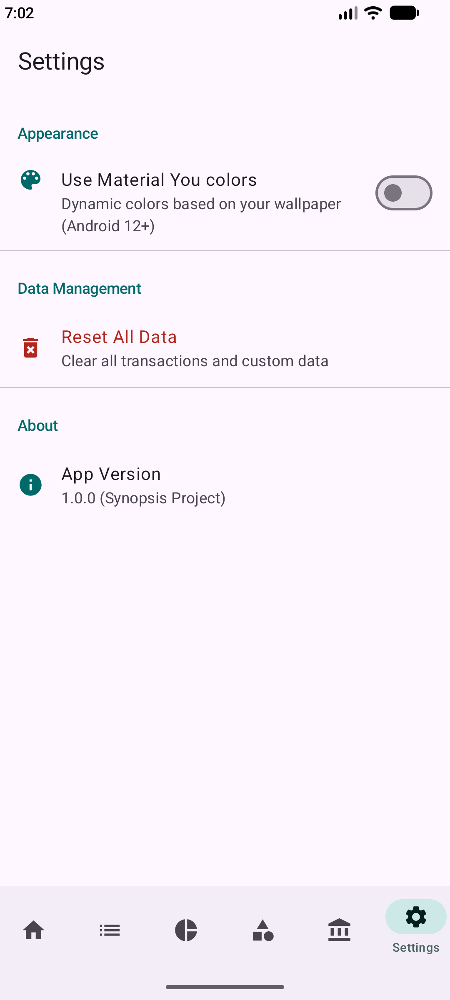

# FinTrack 💰

[](https://www.android.com)
[](https://kotlinlang.org)
[](https://developer.android.com/jetpack/compose)
[](https://developer.android.com/about/versions/nougat)
[](LICENSE)

**FinTrack** is a high-performance, offline-first personal finance tracking application for Android. Built with a focus on privacy and speed, it leverages the modern Android stack—including **Jetpack Compose**, **Room**, and **Hilt**—to deliver an intuitive expense and income tracking experience with clean visual analytics.

---

## 📱 Screenshots

| Dashboard | Transactions | Financial Analysis |
| :---: | :---: | :---: |
|  |  |  |

| Categories | Accounts | Settings |
| :---: | :---: | :---: |
|  |  |  |

---

## ✨ Core Features

* **📊 Intuitive Dashboard**: Real-time summary of total balance, total income, expenses, and quick-access recent transactions.
* **💸 Transaction Management**: Effortlessly log income and expenses with descriptions, account linkage, category tagging, and date timestamps.
* **📈 Visual Analytics**: Native custom pie charts built with **Compose Canvas API** for category spending breakdowns and cash flow indicators.
* **💳 Multi-Account Support**: Manage multiple payment accounts (Cash, Card, Wallet) with live account balance calculations.
* **🏷️ Custom Categories**: Organize income and expense streams with default and custom user categories.
* **🎨 Material You & Theme Personalization**: Support for dynamic wallpaper-based colors on Android 12+ alongside a styled custom palette.
* **🔒 Privacy-First & Offline**: 100% on-device local persistence using Room. Zero remote data collection.

---

## 🏗️ Architecture & Tech Stack

FinTrack follows modern Android development practices and **Clean Architecture** guidelines:

* **Language**: [Kotlin](https://kotlinlang.org/) with Coroutines & Flow for asynchronous reactive state streams.
* **UI Framework**: [Jetpack Compose](https://developer.android.com/jetpack/compose) - Declarative UI development with Material Design 3.
* **Graphics**: Custom charts rendered using the **Compose Canvas API**.
* **Dependency Injection**: [Hilt](https://dagger.dev/hilt/) for dependency graph management and ViewModel injection.
* **Local Persistence**: [Room Database](https://developer.android.com/training/data-storage/room) with multi-table relationships and DAO queries.
* **Preferences**: [Jetpack DataStore](https://developer.android.com/topic/libraries/architecture/datastore) for lightweight key-value preference storage.
* **Navigation**: [Jetpack Navigation Compose](https://developer.android.com/jetpack/compose/navigation) for smooth screen transitions and bottom bar integration.

---

## 📁 Project Structure

```text
com.raye.fintrack
├── core
│   ├── database        # Room Database, DAOs, Entities, SeedData, & Initializer
│   ├── di              # Hilt Modules (DatabaseModule, etc.)
│   ├── model           # Domain models & state representations
│   ├── navigation      # NavGraph, Routes, & Bottom Navigation structure
│   ├── repository      # Data repositories providing clean flow streams
│   └── ui/component    # Reusable UI components (Chips, Dialogs, EmptyState)
├── feature
│   ├── account         # Account list & account creation screen/dialogs
│   ├── analysis        # Spending analytics & Compose Canvas pie charts
│   ├── category        # Category management screen
│   ├── dashboard       # Main financial summary & recent transactions
│   ├── settings        # Dynamic color toggle & database reset options
│   └── transaction     # Transaction history, search, and Add Transaction screen
└── ui/theme            # Material 3 colors, typography, and theme definitions
```

---

## 🚀 Getting Started

### Prerequisites
* Android Studio Ladybug (2024.2.1) or newer
* JDK 17
* Android Device or Emulator running **Android 7.0 (API 24)** or higher

### Building & Running
1. Clone the repository:
   ```bash
   git clone https://github.com/ubaidraye/FinTrack.git
   cd FinTrack
   ```
2. Open the project in Android Studio.
3. Sync project with Gradle files.
4. Run the `:app` configuration on an attached device or emulator.

---

## 📜 License

```text
Copyright 2024 FinTrack Team

Licensed under the Apache License, Version 2.0 (the "License");
you may not use this file except in compliance with the License.
You may obtain a copy of the License at

    http://www.apache.org/licenses/LICENSE-2.0

Unless required by applicable law or agreed to in writing, software
distributed under the License is distributed on an "AS IS" BASIS,
WITHOUT WARRANTIES OR CONDITIONS OF ANY KIND, either express or implied.
See the License for the specific language governing permissions and
limitations under the License.
```
